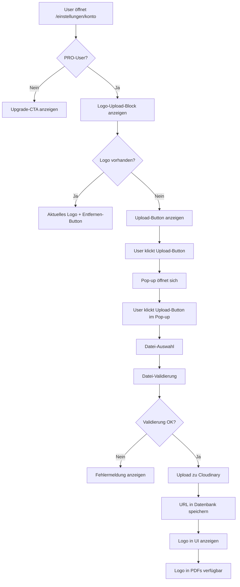

# Logo-Upload-Feature

## Übersicht

Das Logo-Upload-Feature ermöglicht es PRO-Usern, ihr Firmenlogo hochzuladen und automatisch in alle generierten PDF-Angebote einzufügen. Das Feature ist vollständig in die bestehende Benutzeroberfläche integriert und bietet eine intuitive Benutzererfahrung.

## Features

### 🎯 **Hauptfunktionen**
- **PRO-User exklusiv**: Nur für Benutzer mit PRO-Abonnement verfügbar
- **Automatische PDF-Integration**: Logo wird automatisch in alle PDF-Angebote eingefügt
- **Intelligente Positionierung**: Logo wird links oben im PDF platziert mit korrektem Seitenverhältnis
- **Verschiedene Formate**: Unterstützung für PNG, JPG, SVG
- **Transparenz-Optimierung**: Empfehlung für transparente Logos für beste Ergebnisse

### 🔒 **Sicherheit & Validierung**
- **Authentifizierung**: Nur angemeldete Benutzer können Logos hochladen
- **PRO-Status-Prüfung**: Automatische Überprüfung des Abonnement-Status
- **Datei-Validierung**: Größen- und Format-Validierung (max. 5MB)
- **Cloudinary-Integration**: Sichere Cloud-Speicherung der Logos

## Technische Implementierung

### 📁 **Dateistruktur**

```
src/
├── components/
│   ├── logo-upload.tsx              # Hauptkomponente für Logo-Upload
│   └── logo-upload-modal.tsx        # Pop-up-Modal für Upload-Anweisungen
├── app/
│   ├── api/user-data/logo/
│   │   └── route.ts                 # API-Endpunkt für Logo-Upload
│   └── einstellungen/konto/
│       └── page.tsx                 # Integration in Konto-Seite
├── lib/
│   ├── pdf/generate.ts              # PDF-Generierung mit Logo-Integration
│   └── user-data.ts                 # User-Data-Management
└── prisma/
    └── schema.prisma                # Datenbankschema mit companyLogo-Feld
```

### 🗄️ **Datenbankschema**

```prisma
model User {
  id            String    @id @default(cuid())
  // ... andere Felder
  companyLogo   String?   // URL zum Firmenlogo (nur für PRO-User)
  // ... weitere Felder
}
```

### 🔌 **API-Endpunkte**

#### **POST /api/user-data/logo**
- **Zweck**: Logo hochladen
- **Authentifizierung**: Erforderlich
- **PRO-Status**: Erforderlich
- **Request**: `FormData` mit `logo`-Datei
- **Response**: `{ logoUrl: string }`

#### **DELETE /api/user-data/logo**
- **Zweck**: Logo entfernen
- **Authentifizierung**: Erforderlich
- **PRO-Status**: Erforderlich
- **Response**: `{ success: true }`

### 🎨 **UI-Komponenten**

#### **LogoUpload-Komponente**
```typescript
interface LogoUploadProps {
  currentLogo?: string
  onLogoChange: (logoUrl: string) => void
  isProUser: boolean
}
```

**Features:**
- Zeigt aktuelles Logo an (falls vorhanden)
- Upload-Button (nur für PRO-User)
- Upgrade-CTA für FREE-User
- Entfernen-Funktion für vorhandene Logos

#### **LogoUploadModal-Komponente**
```typescript
interface LogoUploadModalProps {
  isOpen: boolean
  onClose: () => void
  onFileSelect: (file: File) => void
  isUploading: boolean
}
```

**Features:**
- Format-Hinweise und Empfehlungen
- Datei-Auswahl mit Validierung
- Vorschau des ausgewählten Logos
- Upload-Button mit Progress-Indikator

### 📄 **PDF-Integration**

#### **Logo-Positionierung**
- **Position**: Links oben im PDF
- **Rahmen**: 250x60px verfügbarer Bereich
- **Seitenverhältnis**: Automatische Berechnung zur Verhinderung von Verzerrungen
- **Skalierung**: Intelligente Skalierung basierend auf Original-Dimensionen

#### **Implementierung**
```typescript
// Logo für PRO-User (links oben)
if (input.userSubscriptionTier === 'PRO' && input.company?.logo) {
  // Logo von URL laden und in PDF einbetten
  const logoResponse = await fetch(input.company.logo)
  if (logoResponse.ok) {
    const logoBytes = await logoResponse.arrayBuffer()
    
    // Versuche PNG zu laden, falls das fehlschlägt, versuche JPG
    let logoImage;
    try {
      logoImage = await pdfDoc.embedPng(logoBytes)
    } catch (pngError) {
      try {
        logoImage = await pdfDoc.embedJpg(logoBytes)
      } catch (jpgError) {
        console.warn('Logo konnte nicht als PNG oder JPG geladen werden:', jpgError)
        logoImage = null
      }
    }
    
    if (logoImage) {
      // Logo positionieren mit korrektem Seitenverhältnis
      const maxWidth = 250
      const maxHeight = 60
      const logoX = 40
      const logoY = height - 80
      
      // Berechne die tatsächlichen Dimensionen basierend auf dem Seitenverhältnis
      const imageWidth = logoImage.width
      const imageHeight = logoImage.height
      const aspectRatio = imageWidth / imageHeight
      
      let logoWidth = maxWidth
      let logoHeight = maxWidth / aspectRatio
      
      // Wenn die Höhe zu groß ist, skaliere basierend auf der Höhe
      if (logoHeight > maxHeight) {
        logoHeight = maxHeight
        logoWidth = maxHeight * aspectRatio
      }
      
      page.drawImage(logoImage, {
        x: logoX,
        y: logoY,
        width: logoWidth,
        height: logoHeight,
      })
    }
  }
}
```

## Benutzerführung

### 🚀 **Für PRO-User**

#### **Logo hochladen:**
1. Navigieren Sie zu `/einstellungen/konto`
2. Scrollen Sie zum "Firmenlogo"-Block
3. Klicken Sie auf den orangen Upload-Button
4. Das Pop-up öffnet sich mit Format-Hinweisen
5. Klicken Sie auf den Upload-Button im Pop-up
6. Wählen Sie Ihre Logo-Datei aus
7. Klicken Sie auf "Logo hochladen"

#### **Logo entfernen:**
1. Navigieren Sie zu `/einstellungen/konto`
2. Scrollen Sie zum "Firmenlogo"-Block
3. Klicken Sie auf "Entfernen" neben dem aktuellen Logo
4. Bestätigen Sie die Löschung

#### **Logo ersetzen:**
1. Entfernen Sie das aktuelle Logo (siehe oben)
2. Laden Sie ein neues Logo hoch (siehe oben)

### 🔒 **Für FREE-User**
- Der "Firmenlogo"-Block zeigt einen Upgrade-CTA
- Klick auf "Auf PRO upgraden" führt zu `/einstellungen/app`
- Keine Upload-Funktionalität verfügbar

## Format-Empfehlungen

### ✅ **Empfohlene Formate**
- **PNG mit transparentem Hintergrund** (empfohlen)
- **SVG** (vektor-basiert für beste Qualität)
- **Hohe Auflösung** (300x300px oder höher)
- **Dateigröße unter 5MB**

### ❌ **Zu vermeiden**
- **JPG mit Hintergrund** (weißer Hintergrund sichtbar)
- **Niedrige Auflösung** (unscharfe Darstellung)
- **Sehr große Dateien** (langsame Ladezeiten)

## Workflow-Diagramm



## Fehlerbehebung

### 🔧 **Häufige Probleme**

#### **"Logo-Upload ist nur für PRO-User verfügbar"**
- **Ursache**: Benutzer hat kein PRO-Abonnement
- **Lösung**: Upgrade auf PRO-Abonnement erforderlich

#### **"Upload fehlgeschlagen"**
- **Ursache**: Datei zu groß oder ungültiges Format
- **Lösung**: Datei auf unter 5MB reduzieren und PNG/JPG/SVG verwenden

#### **"Logo wird nicht in PDF angezeigt"**
- **Ursache**: Logo-URL ist ungültig oder Cloudinary-Fehler
- **Lösung**: Logo erneut hochladen

#### **"Logo ist verzerrt im PDF"**
- **Ursache**: Ungünstiges Seitenverhältnis des Original-Logos
- **Lösung**: Logo mit besserem Seitenverhältnis verwenden

### 🐛 **Debug-Informationen**

#### **Browser-Konsole prüfen:**
```javascript
// Logo-URL in localStorage prüfen
console.log(localStorage.getItem('userData'))

// API-Response prüfen
// Network-Tab: POST /api/user-data/logo
```

#### **Server-Logs prüfen:**
```bash
# Vercel-Logs
vercel logs

# Lokale Entwicklung
npm run dev
# Prüfen Sie die Konsole auf Fehlermeldungen
```

## Sicherheitsaspekte

### 🔐 **Authentifizierung**
- Alle API-Endpunkte erfordern gültige Session
- PRO-Status wird server-seitig validiert
- Keine direkten Cloudinary-Zugriffe vom Client

### 🛡️ **Datei-Validierung**
- Dateigröße-Limit: 5MB
- Erlaubte Formate: PNG, JPG, SVG
- MIME-Type-Validierung
- Cloudinary-Sicherheitsvalidierung

### ☁️ **Cloud-Speicherung**
- Cloudinary für sichere Datei-Speicherung
- Automatische Optimierung und Transformation
- CDN-Integration für schnelle Ladezeiten

## Performance-Optimierungen

### ⚡ **Ladezeiten**
- **Lazy Loading**: Logo wird nur bei Bedarf geladen
- **CDN**: Cloudinary-CDN für schnelle Bildübertragung
- **Caching**: Browser-Caching für wiederholte Zugriffe

### 📱 **Mobile-Optimierung**
- **Responsive Design**: Pop-up optimiert für mobile Geräte
- **Touch-Friendly**: Große Touch-Targets für Upload-Buttons
- **Reduzierte Höhe**: Pop-up passt auf mobile Bildschirme

## Zukünftige Erweiterungen

### 🚀 **Geplante Features**

#### **Automatische Hintergrund-Entfernung**
- KI-basierte Hintergrund-Entfernung für nicht-transparente Logos
- Integration mit Background Removal APIs
- Benutzer-Auswahl: Mit oder ohne automatische Bearbeitung

#### **Logo-Varianten**
- Mehrere Logo-Versionen (hell/dunkel)
- Automatische Anpassung an PDF-Hintergrund
- Logo-Bibliothek für verschiedene Anwendungsfälle

#### **Erweiterte Formate**
- Unterstützung für weitere Bildformate
- Vektor-Logo-Optimierung
- Automatische Format-Konvertierung

### 🔧 **Technische Verbesserungen**

#### **Performance**
- Logo-Caching auf Client-Seite
- Progressive Bildladung
- WebP-Format-Unterstützung

#### **UX-Verbesserungen**
- Drag & Drop Upload
- Logo-Vorschau in verschiedenen Größen
- Batch-Upload für mehrere Logos

## Changelog

### Version 1.0.0 (Aktuell)
- ✅ PRO-User exklusives Logo-Upload-Feature
- ✅ Automatische PDF-Integration
- ✅ Cloudinary-Integration
- ✅ Responsive UI mit Pop-up-Modal
- ✅ Format-Validierung und -Empfehlungen
- ✅ Intelligente Logo-Positionierung im PDF
- ✅ Upgrade-CTA für FREE-User

### Geplante Versionen
- 🔄 Version 1.1.0: Automatische Hintergrund-Entfernung
- 🔄 Version 1.2.0: Logo-Varianten und -Bibliothek
- 🔄 Version 1.3.0: Erweiterte Upload-Features (Drag & Drop)

## Support

### 📞 **Hilfe benötigt?**
- **Dokumentation**: Diese Datei und verlinkte Dokumentationen
- **GitHub Issues**: Für Bug-Reports und Feature-Requests
- **E-Mail Support**: Für technische Probleme

### 🔍 **Weitere Ressourcen**
- [PDF_GENERATION.md](./PDF_GENERATION.md) - PDF-Generierung im Detail
- [USER_DATA_INTEGRATION.md](./USER_DATA_INTEGRATION.md) - Benutzerdaten-Management
- [STRIPE_SUBSCRIPTION_IMPLEMENTATION.md](./STRIPE_SUBSCRIPTION_IMPLEMENTATION.md) - Abonnement-System
